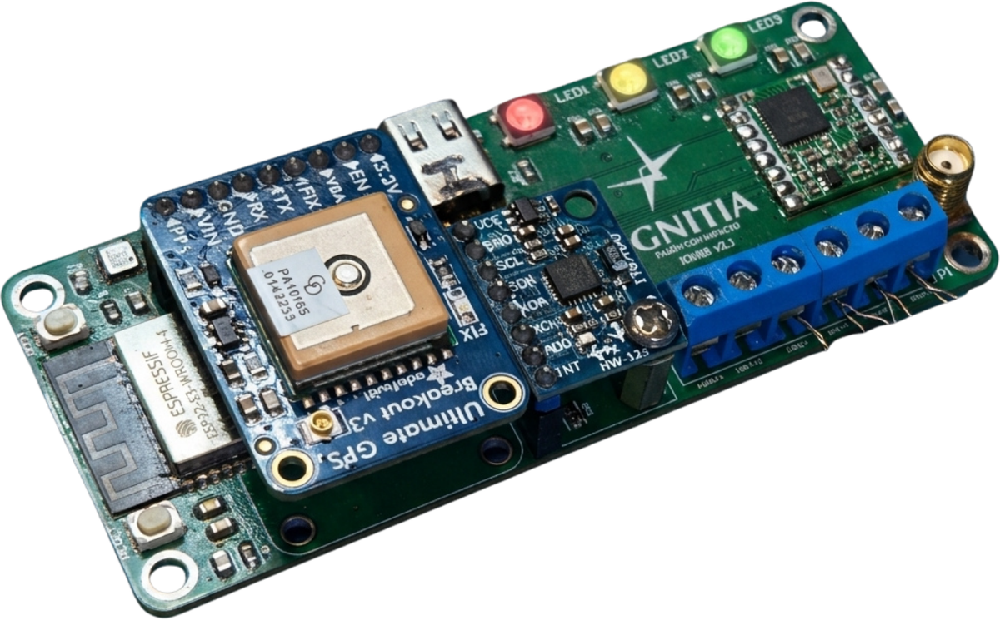
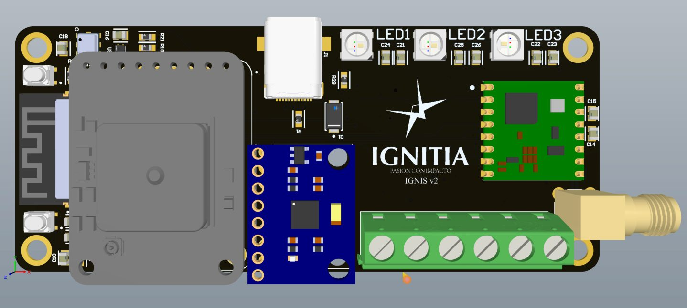
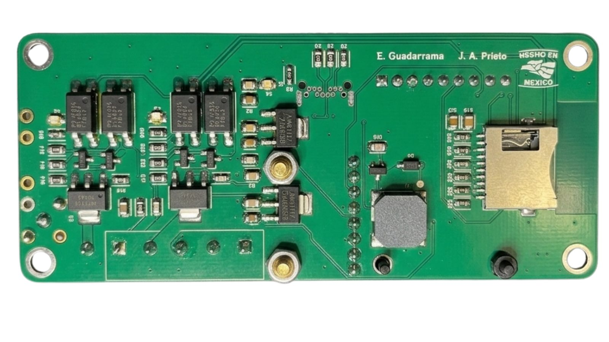
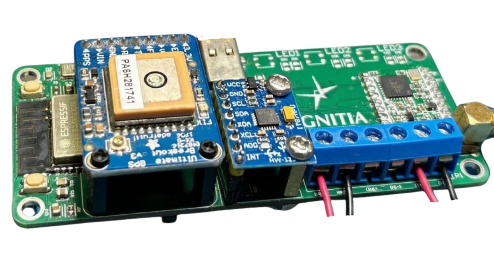
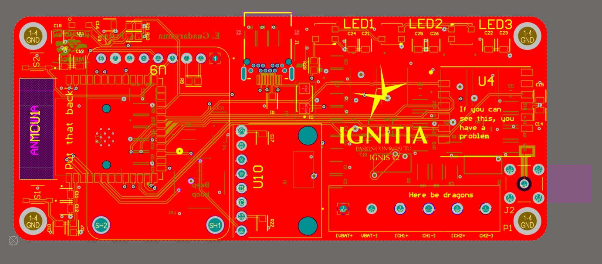
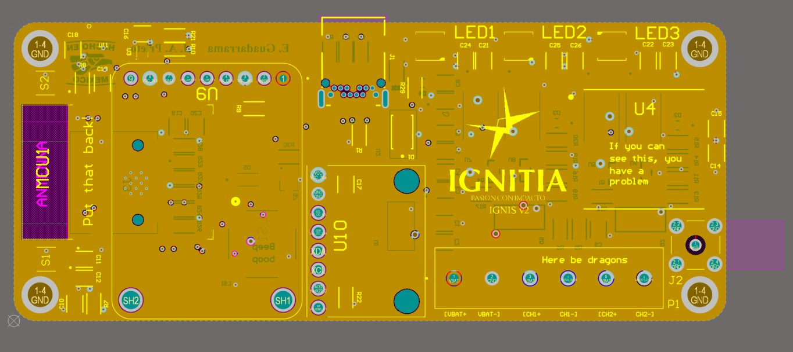
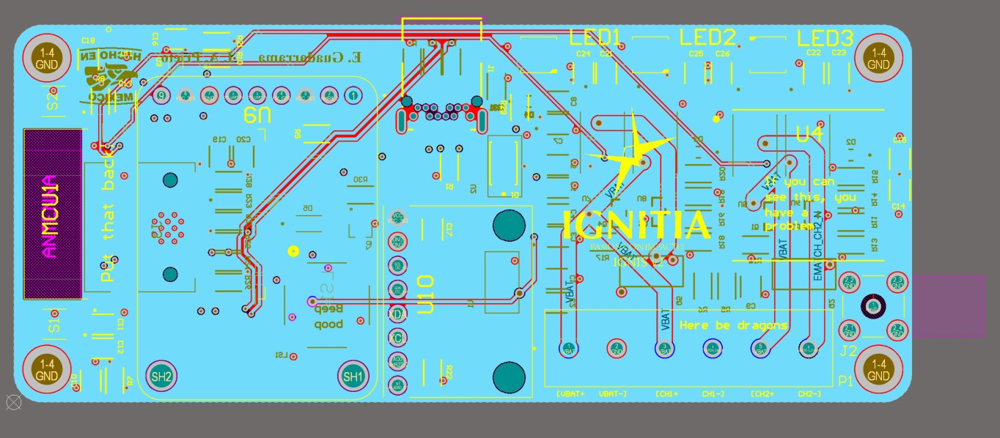
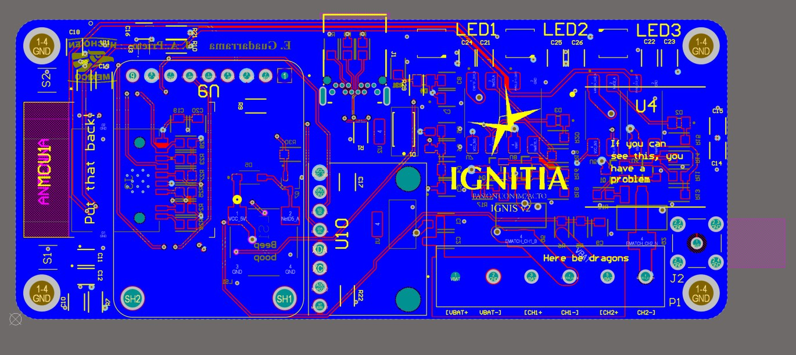
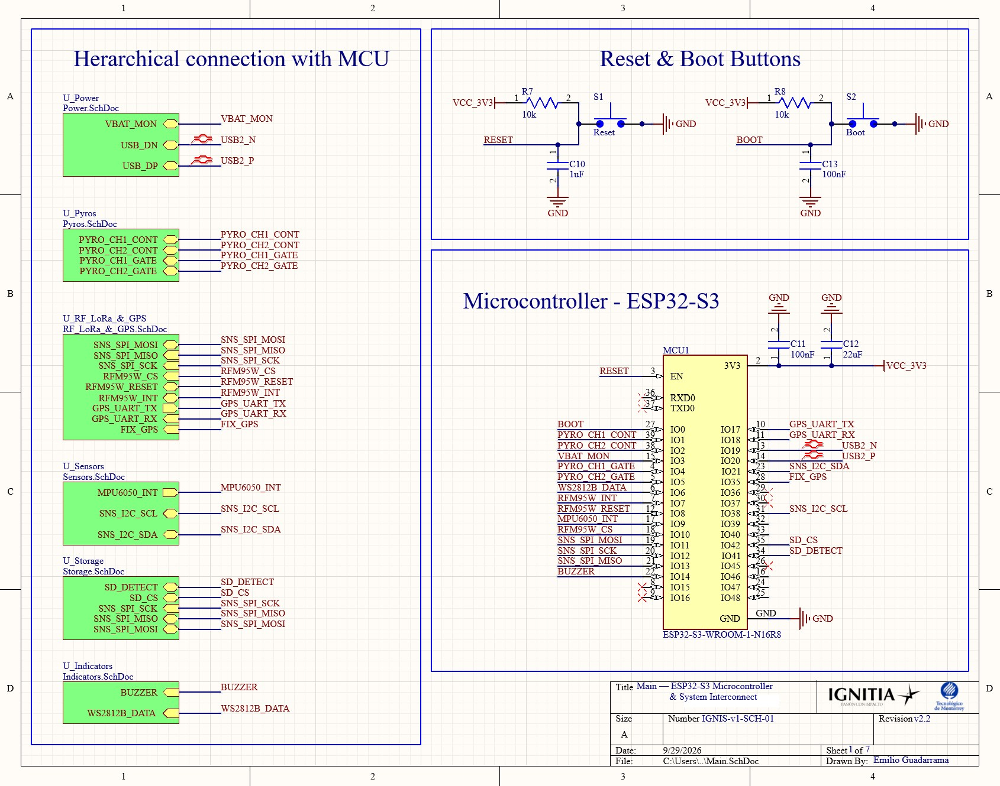
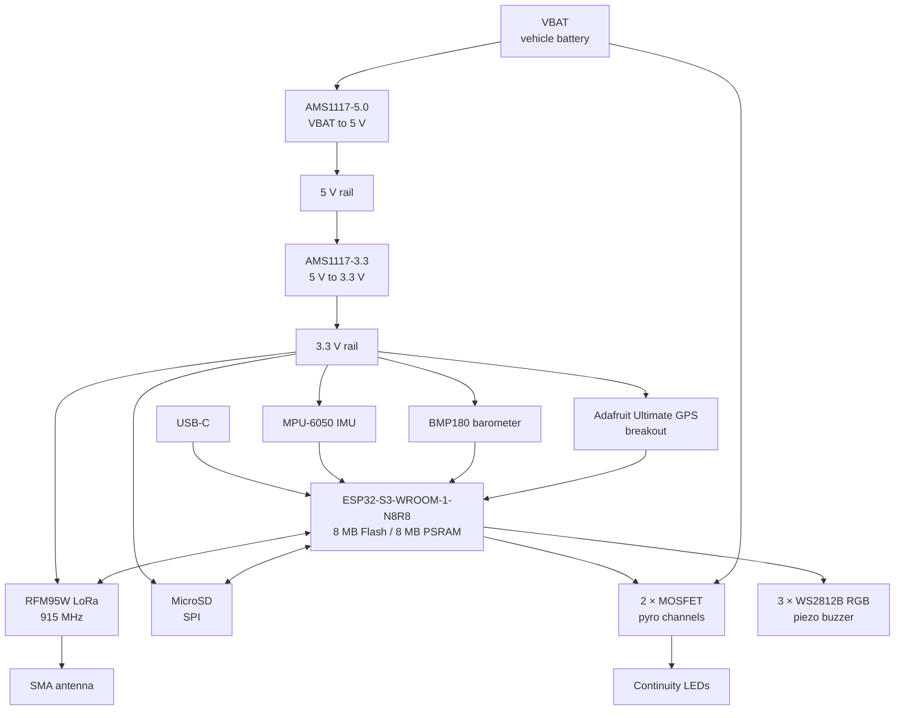

# IGNIS v2 — Flight Computer
### Ignitia Rocket Lab · Tecnológico de Monterrey GDL · LASC 2026

---

> *Designed to survive a rocket. Built by students who refused to buy one off the shelf.*

<p align="center">
  
</p>

---

## What is this?

IGNIS v2 is the second generation SRAD (Student Researched and Developed) flight computer
for Ignitia Rocket Lab's entry in the **Latin American Space Challenge 2026**, held in Brazil.

It handles everything from liftoff to recovery — sensor fusion, apogee detection,
pyrotechnic deployment, real-time LoRa telemetry, and full flight data logging.
No commercial flight computer. No shortcuts.

---

## Flown at LASC 2026

**IGNIS v2.2** is the revision that flew. It was the primary flight computer at the **Latin American Space Challenge 2026** in Brazil, where Ignitia Rocket Lab placed **9th of 25** in the Rocket Challenge, 1 km category.

| Competition | Name | Location | Revision flown |
|---|---|---|---|
| **LASC 2026** | Latin American Space Challenge | Brazil | **IGNIS v2.2** |

The board in the photos below is the v2 design; v2.2 is the corrected revision of it.

---

## What's New in v2.2

v2.2 fixes the problems found while bringing up and testing the first assembled v2 boards:

- **Barometer:** corrected the configuration of one of its interface pins on the I²C bus. Left floating, it made the barometer read ~497 hPa instead of ~830 hPa.
- **RGB LEDs:** fixed the footprint of the addressable LEDs, which didn't match the real part.
- **Recovery channels:** added hardware continuity LEDs to both channels for an immediate visual check on the board.
- **Sensors:** removed the SHT40. Humidity wasn't useful for avionics, and temperature already comes from the barometer.

The lessons from v2.2's bench tests and flight carried into later revisions; the latest is [IGNIS v5](https://github.com/Emilio-Guadarrama/IGNIS-v5-FlightComputer).

---

## Hardware at a Glance

| Block | Component |
|---|---|
| MCU | ESP32-S3-WROOM-1-N8R8 |
| RF Telemetry | RFM95W — 915 MHz LoRa |
| Barometer | BMP180 |
| IMU | MPU-6050 (6-DOF) |
| GPS | Adafruit GPS Breakout |
| Storage | MicroSD — SPI |
| Power | Dual AMS1117 series · VBAT → 5V → 3.3V |
| Pyro | 2-channel MOSFET deployment |
| PCB | 4-layer · Altium Designer · JLCPCB fab |
| Target apogee | 1,000 m — LASC Rocket Challenge |

---

## Gallery

### The board

<table>
  <tr>
    <td width="50%"><br><sub><b>Top side</b> — 3D render from Altium Designer</sub></td>
    <td width="50%"><br><sub><b>Bottom side</b> — assembled: pyro drivers, regulators and microSD</sub></td>
  </tr>
  <tr>
    <td colspan="2"><br><sub><b>Assembled</b> — GPS breakout, IMU and pyro terminal block with leads connected</sub></td>
  </tr>
</table>

### 4-layer stackup

<table>
  <tr>
    <td width="50%"><br><sub>Top layer</sub></td>
    <td width="50%"><br><sub>Ground layer</sub></td>
  </tr>
  <tr>
    <td width="50%"><br><sub>Power layer</sub></td>
    <td width="50%"><br><sub>Bottom layer</sub></td>
  </tr>
</table>

### Schematic



---

## System Architecture



---

## Project Structure

```
IGNIS-v2-FlightComputer/
├── Schematics/
│   ├── Main.SchDoc
│   ├── Power.SchDoc
│   ├── MCU.SchDoc
│   ├── RF_LoRa.SchDoc
│   ├── Sensors.SchDoc
│   ├── GPS.SchDoc
│   ├── Storage.SchDoc
│   ├── Indicators.SchDoc
│   └── Pyro.SchDoc
├── PCB/
│   └── IGNIS_v2.PcbDoc
├── Libraries/
└── Fabrication/
```

---

## Design & Development

**Lead Designer & Author** — [Emilio Guadarrama](https://github.com/Emilio-Guadarrama)  
Vice President, Ignitia Rocket Lab · Avionics & Electronics Lead

**Pyro Circuit** — Aristoteles Prieto  
**Team President** — Maximiliano Funoy Serrano  
**Faculty Advisor** — Dr. José Luis Henríquez Mercado

## Team

**Ignitia Rocket Lab**
Tecnológico de Monterrey — Campus Guadalajara

📧 ignitia.rocketlab@gmail.com

---

*IGNIS v2 is a fully student-designed system.
Every trace routed, every component chosen, every test run — by the team.*

